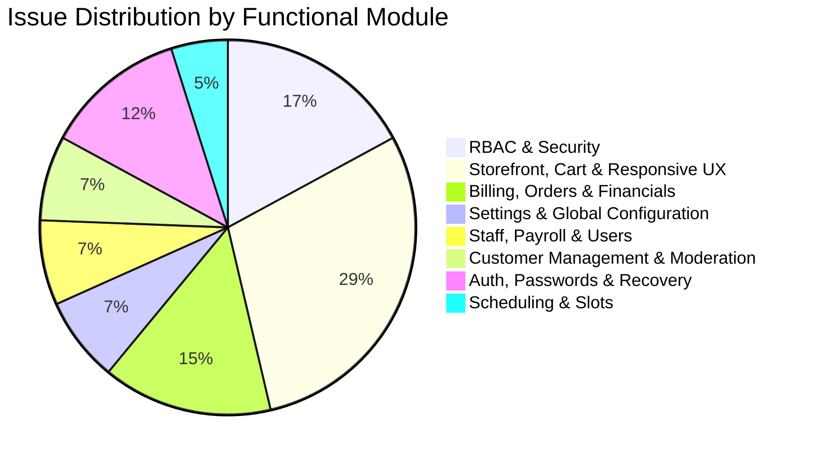

# 🧺 LaundryBD – End-to-End QA Audit & Defect Tracking Master Repository (41 Verified Cards)

[-success?style=for-the-badge&logo=trello)](https://trello.com/b/zpnZp2pZ/kernostudio)
[](https://trello.com/b/zpnZp2pZ/kernostudio)
[-red?style=for-the-badge)](https://trello.com/b/zpnZp2pZ/kernostudio)
[-yellow?style=for-the-badge)](https://trello.com/b/zpnZp2pZ/kernostudio)
[-green?style=for-the-badge)](https://trello.com/b/zpnZp2pZ/kernostudio)
[](https://admin.laundrybd.com)

> **Official Trello Board:** [Kerno Studio – LaundryBD Project](https://trello.com/b/zpnZp2pZ/kernostudio)  
> **Environment Under Test:** [admin.laundrybd.com](https://admin.laundrybd.com) (Admin Portal) & [laundrybd.com](https://laundrybd.com) (Customer Web App)  
> **Repository Maintainer & Lead QA:** [sojibahmed007](https://github.com/sojibahmed007)  
> **Verification Status:** 100% Verified in **Done** List  
> **Release Date:** November 2026

---

## 💼 Portfolio & Executive Case Study

This repository serves as a **production-grade Software Quality Assurance (QA) & Security Audit Case Study** conducted on **LaundryBD** — a real-world on-demand laundry and dry-cleaning platform operating in Sylhet, Bangladesh.

### 🌟 Business Value & Impact Delivered

1. **Financial Leakage Prevention:** Discovered and verified critical calculation omissions where package service charges were excluded from invoices (#4) and coupon codes double-discounted package subscriptions (#5), preventing direct revenue loss.
2. **Security & Authorization Hardening:** Identified severe RBAC privilege escalation vulnerabilities where standard `ADMIN` users could modify global role permissions via unvalidated BFF REST APIs (#7) and un-enforced permission matrix rules (#8).
3. **Data Integrity & Configuration Safeguards:** Uncovered missing input validations allowing corrupted business settings (#12) and API-level tampering of installation-locked currency/timezone constants (#14).
4. **Checkout Conversion & Mobile UX:** Resolved mobile viewport horizontal overflows (#1, #3, #27), chronological pickup slot sorting (#41), and booking endpoint 404s (#33), significantly reducing checkout abandonment.

---

## 📊 Executive QA Summary & KPI Dashboard

```
┌────────────────────────────────────────────────────────┬─────────────┬──────────────┐
│ KPI Metric Category                                    │ Count       │ Ratio / %    │
├────────────────────────────────────────────────────────┼─────────────┼──────────────┤
│ Total Cards Logged & Verified                          │ 41 Items    │ 100.0%       │
│ ├── Confirmed Functional / UI / Security Bugs [BUG]    │ 34 Items    │ 82.9%        │
│ └── Architectural & Feature Improvements [IMP]         │ 7 Items     │ 17.1%        │
├────────────────────────────────────────────────────────┼─────────────┼──────────────┤
│ Severity Breakdown:                                    │             │              │
│ ├── Critical & High (P0 / P1 - Security / Logic / Leak)│ 21 Items    │ 51.2%        │
│ ├── Medium (P2 - Responsive Layout / Session / UI)     │ 12 Items    │ 29.3%        │
│ └── Low (P3 - Minor Visuals / Sanitization / Copy)     │ 8 Items     │ 19.5%        │
├────────────────────────────────────────────────────────┼─────────────┼──────────────┤
│ Target Scope Distribution:                             │             │              │
│ ├── Admin Portal & BFF Backend (admin.laundrybd.com)   │ 23 Items    │ 56.1%        │
│ └── Storefront & Customer Journey (laundrybd.com)      │ 18 Items    │ 43.9%        │
└────────────────────────────────────────────────────────┴─────────────┴──────────────┘
```

### 🎯 Severity & Priority Breakdown

| Severity Level | Count | Share (%) | Primary Impact Scope |
| :--- | :---: | :---: | :--- |
| **🔴 Critical & High (P0/P1)** | **21** | **51.2%** | Package bill omitted (#4), RBAC matrix bypasses (#2, #7, #8), Stale garments cache (#6), User-Staff sync (#10), Settings validation (#12, #14), Financial reconciliations (#18, #19, #20, #21), Broken booking API (#33), Admin recovery (#37), Moderation filter inversion (#40) |
| **🟡 Medium (P2)** | **12** | **29.3%** | Cart & mobile layout breaks (#1, #3), Double salary payments (#11), Security rule overwrites & hard deletes (#16, #17), Session redirects & header states (#25, #26), Address card overflow (#27), Table misalignment (#29), Slot chronological sorting (#41) |
| **🟢 Low (P3)** | **8** | **19.5%** | Password whitespace handling (#15), Ghost focus clicks (#22), Validation text clarity (#23), Offline asset 404 (#24), Input placeholders (#28), Post-login redirect (#30), Package text overflow (#32), Bangla service area search (#36) |

---

## 🗂️ Module-by-Module Distribution



---

## 📋 Master Issue Tracking Table (Cards 1 – 41)

Every card listed below links directly to its official Trello card for complete traceability and auditability.

| # | Type | Severity | Module & Sub-Area | Issue Title & Direct Trello Card Link | Status |
| :-: | :--: | :------: | :---------------- | :------------------------------------ | :----: |
| **1** | `BUG` | 🟡 Medium | Storefront / Cart & Checkout | [[BUG][200][live] Cart Page Layout Breaks When Clicking "Order in 1 Min" with a Long Product Name](https://trello.com/c/MsqG0szu/75-bug200live-cart-page-layout-breaks-when-clicking-order-in-1-min-with-a-long-product-name) | **Done** |
| **2** | `BUG` | 🔴 Critical & High | Security & Access Control (RBAC) | [[BUG][200][live] Role-Based Permission Controls Are Missing for Super Admin](https://trello.com/c/UAydBAJh/62-bug200live-role-based-permission-controls-are-missing-for-super-admin) | **Done** |
| **3** | `BUG` | 🟡 Medium | Storefront / UI Layout | [[BUG][200][live] Mobile Layout Breaks When Product Name Contains Long Text](https://trello.com/c/iRT57cXj/74-bug200live-mobile-layout-breaks-when-product-name-contains-long-text) | **Done** |
| **4** | `BUG` | 🔴 Critical & High | Billing & Order Calculation | [[BUG][200][live] Package Bill Is Excluded from the Total Bill Calculation](https://trello.com/c/aXxCrP1m/70-bug200live-package-bill-is-excluded-from-the-total-bill-calculation) | **Done** |
| **5** | `BUG` | 🔴 Critical & High | Promotions & Coupons | [[BUG][200][live] Coupon Code Can Be Applied to Orders Placed Through a Package](https://trello.com/c/2WNBxW8z/73-bug200live-coupon-code-can-be-applied-to-orders-placed-through-a-package) | **Done** |
| **6** | `BUG` | 🔴 Critical & High | Storefront & Garments Catalog | [[BUG][200][live] Newly Added or Updated Active Garments Do Not Appear on Frontend Price List Due to Stale Cache](https://trello.com/c/xGfU9uBx/76-bug200live-newly-added-or-updated-active-garments-do-not-appear-on-frontend-price-list-due-to-stale-cache) | **Done** |
| **7** | `BUG` | 🔴 Critical & High | Security & Access Control (RBAC) | [[BUG][200][live] ADMIN Can Bypass Read-Only RBAC UI and Modify Global Role Permissions via Backend API](https://trello.com/c/KNiL2Z2T/77-bug200live-admin-can-bypass-read-only-rbac-ui-and-modify-global-role-permissions-via-backend-api) | **Done** |
| **8** | `BUG` | 🔴 Critical & High | Security & Access Control (RBAC) | [[BUG][200][live] RBAC Permission Matrix Changes Are Not Enforced by Frontend or Backend Authorization](https://trello.com/c/Zw24iV67/78-bug200live-rbac-permission-matrix-changes-are-not-enforced-by-frontend-or-backend-authorization) | **Done** |
| **9** | `BUG` | 🔴 Critical & High | Staff Portal & Access Guard | [[BUG][200][live] STAFF Route Guard Inconsistency, Blank Reports Page, Unnecessary Dashboard 403, and Unrestricted Order Detail Controls](https://trello.com/c/IqPenxka/79-bug200live-staff-route-guard-inconsistency-blank-reports-page-unnecessary-dashboard-403-and-unrestricted-order-detail-controls) | **Done** |
| **10** | `BUG` | 🔴 Critical & High | Staff & User Synchronization | [[BUG][200][live] Newly Created User Accounts Do Not Automatically Appear in the Staff List](https://trello.com/c/SX56WQdX/80-bug200live-newly-created-user-accounts-do-not-automatically-appear-in-the-staff-list) | **Done** |
| **11** | `BUG` | 🟡 Medium | Payroll & Salary Management | [[BUG][200][live] Salary Payment Form Remains Active for an Already Paid Month](https://trello.com/c/I8TZbUiA/81-bug200live-salary-payment-form-remains-active-for-an-already-paid-month) | **Done** |
| **12** | `BUG` | 🔴 Critical & High | Settings & Business Configuration | [[BUG][200][live] Missing UI and Backend Validation Allows Invalid Business and Checkout Settings to Be Saved](https://trello.com/c/DnjlJUAU/84-bug200live-missing-ui-and-backend-validation-allows-invalid-business-and-checkout-settings-to-be-saved) | **Done** |
| **13** | `BUG` | 🟡 Medium | Settings & Policy Management | [[BUG][200][live] Obsolete Return & Refund Policy Field and Duplicate Service Areas with Silent Duplicate Rejection](https://trello.com/c/bWWbsZ0e/82-bug200live-obsolete-return-refund-policy-field-and-duplicate-service-areas-with-silent-duplicate-rejection) | **Done** |
| **14** | `BUG` | 🔴 Critical & High | Settings & Global Constants | [[BUG][200][live] UI-Locked Currency and Time Zone Settings Can Be Modified Through Direct API Requests](https://trello.com/c/t73JDnJ5/83-bug200live-ui-locked-currency-and-time-zone-settings-can-be-modified-through-direct-api-requests) | **Done** |
| **15** | `IMP` | 🟢 Low | Authentication & Credentials | [[IMP][200][live] Improve Leading and Trailing Whitespace Validation in Password Fields](https://trello.com/c/yOuXn7kV/46-imp200live-improve-leading-and-trailing-whitespace-validation-in-password-fields) | **Done** |
| **16** | `BUG` | 🟡 Medium | Security & Firewall (IP Blocker) | [[BUG][200][live] Blocking an Already Blocked IP Silently Overwrites the Existing Block Rule](https://trello.com/c/abz3xm6k/85-bug200live-blocking-an-already-blocked-ip-silently-overwrites-the-existing-block-rule) | **Done** |
| **17** | `BUG` | 🟡 Medium | Security & Audit Trail (IP Blocker) | [[BUG][200][live] Unblocking an IP Permanently Deletes Its Record and Removes It from Ended Block History](https://trello.com/c/NlbmnWcx/86-bug200live-unblocking-an-ip-permanently-deletes-its-record-and-removes-it-from-ended-block-history) | **Done** |
| **18** | `IMP` | 🔴 Critical & High | Order & Financial Management | [[IMP][200][live] Implement a Proper Refund Management Feature for Customer Orders](https://trello.com/c/tBAdQ337/87-imp200live-implement-a-proper-refund-management-feature-for-customer-orders) | **Done** |
| **19** | `BUG` | 🔴 Critical & High | Order Status & Billing | [[BUG][200][live] Due Payment Status Is Not Displayed After Order Delivery](https://trello.com/c/nGIl1jJf/88-bug200live-due-payment-status-is-not-displayed-after-order-delivery) | **Done** |
| **20** | `BUG` | 🔴 Critical & High | Payments & Cash on Delivery | [[BUG][200][live] Missing Payment Received Option for Cash on Delivery Orders](https://trello.com/c/wkfd4D48/89-bug200live-missing-payment-received-option-for-cash-on-delivery-orders) | **Done** |
| **21** | `BUG` | 🔴 Critical & High | Reporting & Financial Analytics | [[BUG][200][live] Package Sales Amount Is Not Included in Total Sales](https://trello.com/c/vBvxyZjg/90-bug200live-package-sales-amount-is-not-included-in-total-sales) | **Done** |
| **22** | `BUG` | 🟢 Low | Storefront / Interaction State | [[BUG][200][live] Ghost Click and Focus State Retention After Logout or Form Submission](https://trello.com/c/cw5L9hgj/47-bug200live-ghost-click-and-focus-state-retention-after-logout-or-form-submission) | **Done** |
| **23** | `BUG` | 🟢 Low | Authentication / Validation | [[BUG][200][live] Incorrect Validation Message for Passwords Exceeding Maximum Length](https://trello.com/c/oYpACpSK/48-bug200live-incorrect-validation-message-for-passwords-exceeding-maximum-length) | **Done** |
| **24** | `BUG` | 🟢 Low | Storefront / Network Resilience | [[BUG][200][live] Broken Offline Indicator Image on the "You're Offline" Page](https://trello.com/c/r7xqQCR8/50-bug200live-broken-offline-indicator-image-on-the-youre-offline-page) | **Done** |
| **25** | `BUG` | 🟡 Medium | Authentication / Session Lifecycle | [[BUG][200][live] Incorrect Error State and Missing Login Redirection After Logout](https://trello.com/c/ZiYk5hle/51-bug200live-incorrect-error-state-and-missing-login-redirection-after-logout) | **Done** |
| **26** | `BUG` | 🟡 Medium | Storefront / Responsive Navigation | [[BUG][200][live] Login Button Missing After Logout in Mobile Browser Until Page Refresh](https://trello.com/c/g8f5O4LR/49-bug200live-login-button-missing-after-logout-in-mobile-browser-until-page-refresh) | **Done** |
| **27** | `BUG` | 🟡 Medium | Pickup & Delivery Scheduling | [[BUG][200][live] Long Unbroken Customer Address Overflows Pickup Card and Breaks Page Layout](https://trello.com/c/ulXqrflL/71-bug200live-long-unbroken-customer-address-overflows-pickup-card-and-breaks-page-layout) | **Done** |
| **28** | `BUG` | 🟢 Low | Pickup & Delivery Form | [[BUG][200][live] Add Placeholder Text to Floor Input Field](https://trello.com/c/jiqh3my0/72-bug200live-add-placeholder-text-to-floor-input-field) | **Done** |
| **29** | `BUG` | 🟡 Medium | Admin Garments Management | [[BUG][200][live] Garment Table Layout Breaks Due to Long Text and Incorrect Price Alignment](https://trello.com/c/9gbgbTW6/69-bug200live-garment-table-layout-breaks-due-to-long-text-and-incorrect-price-alignment) | **Done** |
| **30** | `IMP` | 🟢 Low | Authentication / Navigation Flow | [[IMP][200][live] Redirect Users to Home Page After Successful Login or Signup](https://trello.com/c/0vToWQzy/68-imp200live-redirect-users-to-home-page-after-successful-login-or-signup) | **Done** |
| **31** | `IMP` | 🔴 Critical & High | Customer Management & Subscriptions | [[IMP][200][live] Add Customer Creation and Manual Package Assignment Options in Admin Panel](https://trello.com/c/tMrtAIwa/67-imp200live-add-customer-creation-and-manual-package-assignment-options-in-admin-panel) | **Done** |
| **32** | `BUG` | 🟢 Low | Storefront / Package Details | [[BUG][200][live] Long Short Description Text Overflows Its Container in Package Details](https://trello.com/c/kWZ0cyjC/66-bug200live-long-short-description-text-overflows-its-container-in-package-details) | **Done** |
| **33** | `BUG` | 🔴 Critical & High | Booking & API Routing | [[BUG][200][live] Unknown Endpoint Error Occurs When Submitting Booking or Package Requests](https://trello.com/c/DuqVNKmz/65-bug200live-unknown-endpoint-error-occurs-when-submitting-booking-or-package-requests) | **Done** |
| **34** | `IMP` | 🔴 Critical & High | Storefront / Checkout Funnel | [[IMP][200][live] Add Direct Package Booking and Checkout Instead of WhatsApp Redirection](https://trello.com/c/NMKFmfCj/63-imp200live-add-direct-package-booking-and-checkout-instead-of-whatsapp-redirection) | **Done** |
| **35** | `BUG` | 🔴 Critical & High | Admin Catalog & Packages | [[BUG][200][live] Package/Bundle Management Option Missing from Admin Panel](https://trello.com/c/lNsGiMDG/64-bug200live-package-bundle-management-option-missing-from-admin-panel) | **Done** |
| **36** | `IMP` | 🟢 Low | Storefront / Localization | [[IMP][200][live] Add Bengali Language Support to Service Area Checker](https://trello.com/c/l2OBgam3/45-imp200live-add-bengali-language-support-to-service-area-checker) | **Done** |
| **37** | `BUG` | 🔴 Critical & High | Authentication / Recovery | [[BUG][200][live] Super Admin Cannot Recover Forgotten Password Without Another](https://trello.com/c/oPRRlUeP/57-bug200live-super-admin-cannot-recover-forgotten-password-without-another) | **Done** |
| **38** | `BUG` | 🔴 Critical & High | Security & IP Management | [[BUG][200][live] Unblock IP Action Fails Due to Null Reference Error](https://trello.com/c/lFSO8AH2/61-bug200live-unblock-ip-action-fails-due-to-null-reference-error) | **Done** |
| **39** | `IMP` | 🟡 Medium | Customer Drawer & Moderation | [[IMP][200][live] Add Block/Unblock Customer Option to Customer Details Drawer](https://trello.com/c/hbiWGuJT/60-imp200live-add-block-unblock-customer-option-to-customer-details-drawer) | **Done** |
| **40** | `BUG` | 🔴 Critical & High | Customer Moderation & Filtering | [[BUG][200][live] Blocked Customers Tab Displays Active Customers Instead of Blocked Customers](https://trello.com/c/F5OM5oK2/59-bug200live-blocked-customers-tab-displays-active-customers-instead-of-blocked-customers) | **Done** |
| **41** | `BUG` | 🟡 Medium | Pickup & Delivery Scheduling | [[BUG][200][live] Time Slots Are Displayed in Incorrect Order](https://trello.com/c/MruFXmN3/58-bug200live-time-slots-are-displayed-in-incorrect-order) | **Done** |

---

## 🔍 Detailed Card Documentation & Defect Analysis (1 to 41)

### 1. [BUG][200][live] Cart Page Layout Breaks When Clicking "Order in 1 Min" with a Long Product Name

* **Trello Link:** [Open Card on Trello](https://trello.com/c/MsqG0szu/75-bug200live-cart-page-layout-breaks-when-clicking-order-in-1-min-with-a-long-product-name)
* **Classification:** `BUG` | **Severity:** `Medium` | **Module:** `Storefront / Cart & Checkout` (UI/UX & Responsive Layout)
* **Problem Summary:** When a customer adds a product with an unusually long name to the cart and triggers the "Order in 1 Min" quick checkout modal/panel, the container styling does not enforce proper word-wrapping or text truncation. As a result, the modal container overflows horizontally, breaking the layout on mobile and desktop viewports.
* **Expected Result:** Long product titles should wrap cleanly using CSS `overflow-wrap: break-word` or `text-overflow: ellipsis`, maintaining the modal and checkout layout within viewport boundaries.
* **Actual Result:** The flexbox/grid layout expands uncontrollably horizontally, pushing CTA buttons off-screen.

---

### 2. [BUG][200][live] Role-Based Permission Controls Are Missing for Super Admin

* **Trello Link:** [Open Card on Trello](https://trello.com/c/UAydBAJh/62-bug200live-role-based-permission-controls-are-missing-for-super-admin)
* **Classification:** `BUG` | **Severity:** `Critical / High` | **Module:** `Security & Access Control (RBAC)` (Admin Authorization & Matrix)
* **Problem Summary:** In the Role-Based Access Control configuration page (/users/roles), explicit permission matrix overrides and granular policy toggles are completely absent or unconfigurable for the SUPER_ADMIN role. Super Admin implicitly bypasses all policy checks without granular audit capabilities.
* **Expected Result:** Granular permissions should either be clearly documented as immutable system constants or displayed with explicit system-level indicators so administrative privilege boundaries remain visible and auditable.
* **Actual Result:** SUPER_ADMIN role lacks explicit permission matrix controls, leaving privilege boundaries opaque.

---

### 3. [BUG][200][live] Mobile Layout Breaks When Product Name Contains Long Text

* **Trello Link:** [Open Card on Trello](https://trello.com/c/iRT57cXj/74-bug200live-mobile-layout-breaks-when-product-name-contains-long-text)
* **Classification:** `BUG` | **Severity:** `Medium` | **Module:** `Storefront / UI Layout` (Mobile Responsive View)
* **Problem Summary:** On mobile viewports (< 480px), product cards displaying names with long unhyphenated words or extended strings fail to break lines properly, causing the card width to exceed the screen width and introducing horizontal scroll bars on the main storefront catalog.
* **Expected Result:** Product cards should enforce strict responsive constraints with CSS `line-clamp` or responsive typography that adapts seamlessly to small screens.
* **Actual Result:** Unbroken text causes horizontal page overflow and misaligns price/action badges on mobile.

---

### 4. [BUG][200][live] Package Bill Is Excluded from the Total Bill Calculation

* **Trello Link:** [Open Card on Trello](https://trello.com/c/aXxCrP1m/70-bug200live-package-bill-is-excluded-from-the-total-bill-calculation)
* **Classification:** `BUG` | **Severity:** `Critical / High` | **Module:** `Billing & Order Calculation` (Pricing & Financial Logic)
* **Problem Summary:** When a customer purchases a package or places an order utilizing package service units, the package subscription/fee is omitted from the aggregate order total during checkout and database persistence. Customers are under-billed, creating critical revenue leakage.
* **Expected Result:** The pricing computation engine must aggregate base garment charges, package tier fees, and delivery surcharges into the final payable invoice total.
* **Actual Result:** Package charges evaluate to zero in the final calculation step, omitting required subscription billing.

---

### 5. [BUG][200][live] Coupon Code Can Be Applied to Orders Placed Through a Package

* **Trello Link:** [Open Card on Trello](https://trello.com/c/2WNBxW8z/73-bug200live-coupon-code-can-be-applied-to-orders-placed-through-a-package)
* **Classification:** `BUG` | **Severity:** `Critical / High` | **Module:** `Promotions & Coupons` (Discount Validation Engine)
* **Problem Summary:** Promotional discount coupons can be applied to orders that are already heavily discounted or fully covered by an active laundry package. Double-dipping discounts results in negative order balances or excessive promotional losses.
* **Expected Result:** The coupon validation engine should check `order.has_package` and reject coupons with a clear validation message: "Coupons cannot be combined with package-based orders."
* **Actual Result:** Coupons apply indiscriminately regardless of package coverage, compounding multiple promotional discounts.

---

### 6. [BUG][200][live] Newly Added or Updated Active Garments Do Not Appear on Frontend Price List Due to Stale Cache

* **Trello Link:** [Open Card on Trello](https://trello.com/c/xGfU9uBx/76-bug200live-newly-added-or-updated-active-garments-do-not-appear-on-frontend-price-list-due-to-stale-cache)
* **Classification:** `BUG` | **Severity:** `Critical / High` | **Module:** `Storefront & Garments Catalog` (Caching & Data Synchronization)
* **Problem Summary:** When an administrator creates a new garment item or updates prices via the admin portal, the customer storefront price list continues serving stale cached data. Cache invalidation hooks (Redis/HTTP cache tags) fail to trigger on mutation.
* **Expected Result:** Modifications to garments in the admin panel should trigger an immediate cache invalidation/revalidation hook for the storefront price list.
* **Actual Result:** Frontend displays outdated items and prices until manual server restarts or long TTL expiry.

---

### 7. [BUG][200][live] ADMIN Can Bypass Read-Only RBAC UI and Modify Global Role Permissions via Backend API

* **Trello Link:** [Open Card on Trello](https://trello.com/c/KNiL2Z2T/77-bug200live-admin-can-bypass-read-only-rbac-ui-and-modify-global-role-permissions-via-backend-api)
* **Classification:** `BUG` | **Severity:** `Critical / High` | **Module:** `Security & Access Control (RBAC)` (API Privilege Escalation)
* **Problem Summary:** While the admin frontend UI renders the RBAC permission matrix as disabled/read-only for standard ADMIN users, the backend endpoint (e.g. PUT /api/bff/admin/roles/permissions) lacks server-side role validation. A standard ADMIN can forge API payloads and grant themselves or other roles elevated permissions.
* **Expected Result:** The backend API must enforce strict role verification: only SUPER_ADMIN should be authorized to update role permission mappings (returning 403 Forbidden for ADMIN).
* **Actual Result:** API returns 200 OK and mutates permissions despite the UI being locked, enabling privilege escalation.

---

### 8. [BUG][200][live] RBAC Permission Matrix Changes Are Not Enforced by Frontend or Backend Authorization

* **Trello Link:** [Open Card on Trello](https://trello.com/c/Zw24iV67/78-bug200live-rbac-permission-matrix-changes-are-not-enforced-by-frontend-or-backend-authorization)
* **Classification:** `BUG` | **Severity:** `Critical / High` | **Module:** `Security & Access Control (RBAC)` (Policy Enforcement & Matrix)
* **Problem Summary:** When permissions are modified and saved in the RBAC matrix (e.g., toggling staff edit off for MANAGER), neither frontend route guards nor backend controller middlewares enforce the updated permissions. The authorization logic relies on hardcoded role checks rather than the dynamic permissions table.
* **Expected Result:** All middleware and route checks should query the active permission matrix for the role, immediately enforcing permission revoking or granting.
* **Actual Result:** Changes in the matrix have zero effect on actual authorization enforcement in both UI and API.

---

### 9. [BUG][200][live] STAFF Route Guard Inconsistency, Blank Reports Page, Unnecessary Dashboard 403, and Unrestricted Order Detail Controls

* **Trello Link:** [Open Card on Trello](https://trello.com/c/IqPenxka/79-bug200live-staff-route-guard-inconsistency-blank-reports-page-unnecessary-dashboard-403-and-unrestricted-order-detail-controls)
* **Classification:** `BUG` | **Severity:** `Critical / High` | **Module:** `Staff Portal & Access Guard` (Route Guards & Permissions)
* **Problem Summary:** Users with the STAFF role encounter broken UI states: accessing /reports renders an empty blank page instead of an unauthorized message, dashboard API calls trigger unhandled 403 errors, and order detail screens fail to disable sensitive financial controls.
* **Expected Result:** Staff routes should have consistent guards redirecting unauthorized screens cleanly, with appropriate endpoint filtering and read-only order status controls.
* **Actual Result:** Staff users encounter silent page crashes, console errors, and exposed controls that fail upon interaction.

---

### 10. [BUG][200][live] Newly Created User Accounts Do Not Automatically Appear in the Staff List

* **Trello Link:** [Open Card on Trello](https://trello.com/c/SX56WQdX/80-bug200live-newly-created-user-accounts-do-not-automatically-appear-in-the-staff-list)
* **Classification:** `BUG` | **Severity:** `Critical / High` | **Module:** `Staff & User Synchronization` (User-to-Staff Entity Linking)
* **Problem Summary:** When a user is assigned a STAFF or MANAGER role in /users, no corresponding staff profile record is created in /staff. Attempting to add them manually from /staff causes a 409 Conflict ("User with this phone already exists"), permanently desynchronizing user accounts and employee records.
* **Expected Result:** Assigning a staff role to an existing user should automatically link or generate the corresponding employee profile in the staff roster.
* **Actual Result:** User accounts with staff roles remain detached, blocking payroll processing and profile management.

---

### 11. [BUG][200][live] Salary Payment Form Remains Active for an Already Paid Month

* **Trello Link:** [Open Card on Trello](https://trello.com/c/I8TZbUiA/81-bug200live-salary-payment-form-remains-active-for-an-already-paid-month)
* **Classification:** `BUG` | **Severity:** `Medium` | **Module:** `Payroll & Salary Management` (Form State & Double Payouts)
* **Problem Summary:** In the Staff Management page (/staff), the "Process Salary" / "Pay" action button remains enabled for employees who have already received their full salary for the current billing cycle. The UI does not reflect paid state until after a redundant submission triggers a backend error.
* **Expected Result:** The Pay action should display a "Paid" status badge or disable the action for previously disbursed payroll periods.
* **Actual Result:** Admins can open the dialog and attempt redundant payouts, receiving unhandled submission errors.

---

### 12. [BUG][200][live] Missing UI and Backend Validation Allows Invalid Business and Checkout Settings to Be Saved

* **Trello Link:** [Open Card on Trello](https://trello.com/c/DnjlJUAU/84-bug200live-missing-ui-and-backend-validation-allows-invalid-business-and-checkout-settings-to-be-saved)
* **Classification:** `BUG` | **Severity:** `Critical / High` | **Module:** `Settings & Business Configuration` (Input Validation (UI & BFF API))
* **Problem Summary:** The /settings form accepts malformed inputs across critical business configuration fields: support_email="bad-email", business_phone="123", site_url="invalid-url", max_addresses=0, and max_pickup_days_ahead=0 are all saved with 200 OK by both UI and backend API without schema validation.
* **Expected Result:** Both frontend forms and backend schema validators must enforce strict regex, positive non-zero limits, and valid RFC email/URL standards.
* **Actual Result:** Corrupt settings are written directly to the database, breaking storefront checkout logic downstream.

---

### 13. [BUG][200][live] Obsolete Return & Refund Policy Field and Duplicate Service Areas with Silent Duplicate Rejection

* **Trello Link:** [Open Card on Trello](https://trello.com/c/bWWbsZ0e/82-bug200live-obsolete-return-refund-policy-field-and-duplicate-service-areas-with-silent-duplicate-rejection)
* **Classification:** `BUG` | **Severity:** `Medium` | **Module:** `Settings & Policy Management` (Dead Config & Duplicate Areas)
* **Problem Summary:** The main settings page retains an obsolete markdown policy field that is completely disconnected from the live customer refund policy page (/en/return-policy). Additionally, the service area list contains duplicates ("Subhanighat" & "Sobhanighat") and silently drops duplicate additions without toast feedback.
* **Expected Result:** Obsolete legacy settings fields should be removed, duplicate service areas normalized, and duplicate input attempts met with informative UI toast notifications.
* **Actual Result:** Dead configuration fields confuse administrators, and silent UI rejections provide poor UX.

---

### 14. [BUG][200][live] UI-Locked Currency and Time Zone Settings Can Be Modified Through Direct API Requests

* **Trello Link:** [Open Card on Trello](https://trello.com/c/t73JDnJ5/83-bug200live-ui-locked-currency-and-time-zone-settings-can-be-modified-through-direct-api-requests)
* **Classification:** `BUG` | **Severity:** `Critical / High` | **Module:** `Settings & Global Constants` (Fixed Settings Immutability)
* **Problem Summary:** Although the Currency (BDT) and Time Zone (Asia/Dhaka) inputs are disabled in the web UI with the label "Fixed for this installation", direct PUT requests to /api/bff/admin/settings/currency and /timezone succeed with HTTP 200 OK, altering global financial calculations and scheduling timestamps.
* **Expected Result:** System-critical constants must be immutable on the backend, returning HTTP 400 Bad Request or 403 Forbidden when targeted by modification requests.
* **Actual Result:** Backend mutates immutable installation constants when bypassed via REST clients.

---

### 15. [IMP][200][live] Improve Leading and Trailing Whitespace Validation in Password Fields

* **Trello Link:** [Open Card on Trello](https://trello.com/c/yOuXn7kV/46-imp200live-improve-leading-and-trailing-whitespace-validation-in-password-fields)
* **Classification:** `IMP` | **Severity:** `Low` | **Module:** `Authentication & Credentials` (Whitespace Input Sanitization)
* **Problem Summary:** Users inadvertently copying passwords with accidental leading or trailing whitespace encounter authentication failures or create passwords with unintentional spaces without clear visual feedback.
* **Expected Result:** Password inputs should either automatically trim accidental whitespaces or provide inline validation warnings informing users of trailing/leading space characters.
* **Actual Result:** Whitespaces are processed silently, causing user lockout and unnecessary password reset cycles.

---

### 16. [BUG][200][live] Blocking an Already Blocked IP Silently Overwrites the Existing Block Rule

* **Trello Link:** [Open Card on Trello](https://trello.com/c/abz3xm6k/85-bug200live-blocking-an-already-blocked-ip-silently-overwrites-the-existing-block-rule)
* **Classification:** `BUG` | **Severity:** `Medium` | **Module:** `Security & Firewall (IP Blocker)` (Rule Overwrite & Conflict Handling)
* **Problem Summary:** When an admin attempts to block an IP that is already actively blocked with a specific duration (e.g., 24 hours), the API returns 201 Created and silently overwrites the existing rule with a permanent ("Until unblocked") duration without warning or conflict prompt.
* **Expected Result:** The endpoint should detect active duplicate rules and return HTTP 409 Conflict, or prompt the admin to confirm rule modification.
* **Actual Result:** Previous block reasons and specific expiration timers are wiped out silently.

---

### 17. [BUG][200][live] Unblocking an IP Permanently Deletes Its Record and Removes It from Ended Block History

* **Trello Link:** [Open Card on Trello](https://trello.com/c/NlbmnWcx/86-bug200live-unblocking-an-ip-permanently-deletes-its-record-and-removes-it-from-ended-block-history)
* **Classification:** `BUG` | **Severity:** `Medium` | **Module:** `Security & Audit Trail (IP Blocker)` (Hard Deletes vs Soft Deletes)
* **Problem Summary:** Unblocking an IP address via the security management UI triggers a hard DELETE request, permanently erasing the record from the database. Consequently, the "Including ended" audit tab shows zero historical records for manually unblocked IPs.
* **Expected Result:** Unblocking an IP should perform a soft-update (setting `is_active=false` and `ended_at=NOW()`), preserving the complete security audit trail.
* **Actual Result:** Hard deletion destroys security incident history, preventing forensics and historical trend analysis.

---

### 18. [IMP][200][live] Implement a Proper Refund Management Feature for Customer Orders

* **Trello Link:** [Open Card on Trello](https://trello.com/c/tBAdQ337/87-imp200live-implement-a-proper-refund-management-feature-for-customer-orders)
* **Classification:** `IMP` | **Severity:** `Critical / High` | **Module:** `Order & Financial Management` (Refund Life-cycle & Ledger)
* **Problem Summary:** Currently, when customer orders are cancelled or disputed after payment, the admin panel lacks a structured refund initiation and tracking mechanism. Financial reconciliations must be executed manually off-platform.
* **Expected Result:** A structured "Refund Order" workflow with partial/full refund amount inputs, refund reason selection, and automated ledger adjustments should be integrated into order details.
* **Actual Result:** No native refund module exists in the admin panel, leading to manual accounting discrepancies.

---

### 19. [BUG][200][live] Due Payment Status Is Not Displayed After Order Delivery

* **Trello Link:** [Open Card on Trello](https://trello.com/c/nGIl1jJf/88-bug200live-due-payment-status-is-not-displayed-after-order-delivery)
* **Classification:** `BUG` | **Severity:** `Critical / High` | **Module:** `Order Status & Billing` (Due Status Visibility Post-Delivery)
* **Problem Summary:** When an order is delivered to a customer without upfront settlement (credit/partial payment), marking the order as "Delivered" overwrites the prominent payment status badge. Staff and delivery drivers cannot easily distinguish whether an order has pending dues.
* **Expected Result:** The order listing and detail views should clearly display compound status flags (e.g. "Delivered (Payment Due)") until total receivables are cleared.
* **Actual Result:** Delivered orders mask unpaid statuses, resulting in missed cash collection at delivery.

---

### 20. [BUG][200][live] Missing Payment Received Option for Cash on Delivery Orders

* **Trello Link:** [Open Card on Trello](https://trello.com/c/wkfd4D48/89-bug200live-missing-payment-received-option-for-cash-on-delivery-orders)
* **Classification:** `BUG` | **Severity:** `Critical / High` | **Module:** `Payments & Cash on Delivery` (COD Payment Reconciliation)
* **Problem Summary:** For orders placed under Cash on Delivery (COD), the admin order drawer lacks an explicit "Mark Payment Received" action. Admins are forced to modify the general order status or edit invoice states indirectly.
* **Expected Result:** A dedicated "Confirm COD Collection" button should be available in the order action panel to record the received cash amount, collector identity, and timestamp.
* **Actual Result:** Admins have no clean mechanism to reconcile cash collected by riders.

---

### 21. [BUG][200][live] Package Sales Amount Is Not Included in Total Sales

* **Trello Link:** [Open Card on Trello](https://trello.com/c/vBvxyZjg/90-bug200live-package-sales-amount-is-not-included-in-total-sales)
* **Classification:** `BUG` | **Severity:** `Critical / High` | **Module:** `Reporting & Financial Analytics` (Package Revenue Aggregation)
* **Problem Summary:** The administrative financial dashboard aggregates revenue exclusively from standard garment orders. Package/subscription sales amounts are omitted from the "Total Sales" KPI cards and executive reports.
* **Expected Result:** Total Sales calculations must incorporate all revenue streams, including direct garment washing, iron services, and package subscription plans.
* **Actual Result:** Financial overview cards show skewed, lower-than-actual revenue figures.

---

### 22. [BUG][200][live] Ghost Click and Focus State Retention After Logout or Form Submission

* **Trello Link:** [Open Card on Trello](https://trello.com/c/cw5L9hgj/47-bug200live-ghost-click-and-focus-state-retention-after-logout-or-form-submission)
* **Classification:** `BUG` | **Severity:** `Low` | **Module:** `Storefront / Interaction State` (DOM Focus & Event Cleanup)
* **Problem Summary:** Submitting authentication forms or clicking logout leaves lingering focus rings and synthetic hover states on mobile touchscreens and desktop browsers, causing secondary inadvertent clicks.
* **Expected Result:** Active button focus and touch ripple states should be programmatically blurred and cleared upon form submission or route transitions.
* **Actual Result:** Buttons retain visual focus rings and trigger ghost click events.

---

### 23. [BUG][200][live] Incorrect Validation Message for Passwords Exceeding Maximum Length

* **Trello Link:** [Open Card on Trello](https://trello.com/c/oYpACpSK/48-bug200live-incorrect-validation-message-for-passwords-exceeding-maximum-length)
* **Classification:** `BUG` | **Severity:** `Low` | **Module:** `Authentication / Validation` (Error Message Accuracy)
* **Problem Summary:** When a user enters a password that exceeds the allowable length limit (e.g. > 64 chars), the client-side validation displays a generic "Password is invalid" or "Minimum 8 characters required" message instead of specifying the maximum character restriction.
* **Expected Result:** The validation error should clearly state: "Password cannot exceed 64 characters."
* **Actual Result:** Misleading validation copy confuses users attempting to set strong passwords.

---

### 24. [BUG][200][live] Broken Offline Indicator Image on the "You're Offline" Page

* **Trello Link:** [Open Card on Trello](https://trello.com/c/r7xqQCR8/50-bug200live-broken-offline-indicator-image-on-the-youre-offline-page)
* **Classification:** `BUG` | **Severity:** `Low` | **Module:** `Storefront / Network Resilience` (Offline State Asset 404)
* **Problem Summary:** When network connectivity drops and the service worker displays the offline fallback screen, the illustration graphic asset fails to load (returning 404 or missing local cache), displaying a broken image placeholder icon.
* **Expected Result:** The offline graphic asset should be precached by the service worker during PWA install, rendering cleanly offline.
* **Actual Result:** A broken image icon appears above the offline banner text.

---

### 25. [BUG][200][live] Incorrect Error State and Missing Login Redirection After Logout

* **Trello Link:** [Open Card on Trello](https://trello.com/c/ZiYk5hle/51-bug200live-incorrect-error-state-and-missing-login-redirection-after-logout)
* **Classification:** `BUG` | **Severity:** `Medium` | **Module:** `Authentication / Session Lifecycle` (Logout Error Handlers & Redirect)
* **Problem Summary:** Clicking logout clears session tokens but fails to handle post-logout routing cleanly. The UI displays an unhandled error toast ("Failed to fetch user state") and remains stranded on the protected URL rather than redirecting to /login.
* **Expected Result:** Logout should gracefully clear local state, prevent downstream user-fetch errors, and immediately redirect to /login or home.
* **Actual Result:** A red error toast appears and the page remains stuck on an unauthenticated route.

---

### 26. [BUG][200][live] Login Button Missing After Logout in Mobile Browser Until Page Refresh

* **Trello Link:** [Open Card on Trello](https://trello.com/c/g8f5O4LR/49-bug200live-login-button-missing-after-logout-in-mobile-browser-until-page-refresh)
* **Classification:** `BUG` | **Severity:** `Medium` | **Module:** `Storefront / Responsive Navigation` (Mobile Header Re-render on Logout)
* **Problem Summary:** On mobile viewports, logging out from the navigation drawer closes the drawer, but the top navbar fails to trigger a re-render. The user avatar disappears, yet the "Login" button does not show up until the user manually triggers a hard page refresh.
* **Expected Result:** The mobile header authentication CTA should reactively toggle between Avatar and Login button based on active auth state.
* **Actual Result:** The header retains an empty void where the action button belongs until manual refresh.

---

### 27. [BUG][200][live] Long Unbroken Customer Address Overflows Pickup Card and Breaks Page Layout

* **Trello Link:** [Open Card on Trello](https://trello.com/c/ulXqrflL/71-bug200live-long-unbroken-customer-address-overflows-pickup-card-and-breaks-page-layout)
* **Classification:** `BUG` | **Severity:** `Medium` | **Module:** `Pickup & Delivery Scheduling` (Address Text Wrapping & Overflow)
* **Problem Summary:** When a customer enters an extensive delivery address without manual line breaks, the address string overflows the pickup schedule summary card in checkout, pushing dates and times outside the viewport.
* **Expected Result:** Address containers must enforce `word-break: break-word` and container containment to accommodate long Bangladeshi urban address descriptions.
* **Actual Result:** Text flows horizontally past parent boundaries, destroying card geometry.

---

### 28. [BUG][200][live] Add Placeholder Text to Floor Input Field

* **Trello Link:** [Open Card on Trello](https://trello.com/c/jiqh3my0/72-bug200live-add-placeholder-text-to-floor-input-field)
* **Classification:** `BUG` | **Severity:** `Low` | **Module:** `Pickup & Delivery Form` (Input Placeholders & Affordance)
* **Problem Summary:** The building floor input in the delivery address modal lacks placeholder text (e.g., "e.g. 4th Floor, Flat 4B"), leading to ambiguous entries where customers type apartment names or leave it blank.
* **Expected Result:** Provide clear, localized placeholder cues ("e.g., 3rd Floor / Flat 3A") to streamline delivery dispatch.
* **Actual Result:** Field displays an empty blank box without contextual guidance.

---

### 29. [BUG][200][live] Garment Table Layout Breaks Due to Long Text and Incorrect Price Alignment

* **Trello Link:** [Open Card on Trello](https://trello.com/c/9gbgbTW6/69-bug200live-garment-table-layout-breaks-due-to-long-text-and-incorrect-price-alignment)
* **Classification:** `BUG` | **Severity:** `Medium` | **Module:** `Admin Garments Management` (Table Responsive Columns & Alignment)
* **Problem Summary:** In the admin Garments management catalog (/garments), item titles with detailed descriptions distort table column widths. Prices become misaligned with column headers, and action buttons wrap onto awkward double lines.
* **Expected Result:** Table headers and numeric currency columns should maintain fixed alignments with truncation tooltips for extended titles.
* **Actual Result:** Columns shift unpredictably, causing visual misalignment between header labels and price cells.

---

### 30. [IMP][200][live] Redirect Users to Home Page After Successful Login or Signup

* **Trello Link:** [Open Card on Trello](https://trello.com/c/0vToWQzy/68-imp200live-redirect-users-to-home-page-after-successful-login-or-signup)
* **Classification:** `IMP` | **Severity:** `Low` | **Module:** `Authentication / Navigation Flow` (Post-Login Landing UX)
* **Problem Summary:** After successful registration or login, customers are redirected to an arbitrary account dashboard rather than being returned to their previous intent (such as the cart or the home page to start shopping).
* **Expected Result:** Support `redirect_to` query params to return users to their previous workflow, defaulting to the Homepage if no specific route was active.
* **Actual Result:** Users are dropped on a generic account page and must manually navigate back to shopping.

---

### 31. [IMP][200][live] Add Customer Creation and Manual Package Assignment Options in Admin Panel

* **Trello Link:** [Open Card on Trello](https://trello.com/c/tMrtAIwa/67-imp200live-add-customer-creation-and-manual-package-assignment-options-in-admin-panel)
* **Classification:** `IMP` | **Severity:** `Critical / High` | **Module:** `Customer Management & Subscriptions` (Manual Package Assignment)
* **Problem Summary:** Admins cannot manually onboard customers or assign laundry subscription packages over phone/offline desk requests. All package subscriptions currently require customer self-service through the storefront.
* **Expected Result:** Admin panel should provide a "+ New Customer" creation dialog and a "Grant/Assign Package" drawer in customer details.
* **Actual Result:** Admins have no interface to manually enroll corporate or walk-in package subscribers.

---

### 32. [BUG][200][live] Long Short Description Text Overflows Its Container in Package Details

* **Trello Link:** [Open Card on Trello](https://trello.com/c/kWZ0cyjC/66-bug200live-long-short-description-text-overflows-its-container-in-package-details)
* **Classification:** `BUG` | **Severity:** `Low` | **Module:** `Storefront / Package Details` (Text Container Overflow)
* **Problem Summary:** On package overview cards, when marketing adds an extended summary into the "Short Description" field, the text spills outside the fixed-height card container and overlaps the subscription CTA button.
* **Expected Result:** Card descriptions should utilize dynamic height or clamp to 3 lines (`-webkit-line-clamp: 3`) with a "Read more" toggle.
* **Actual Result:** Text bleeds over the package pricing and "Subscribe" button.

---

### 33. [BUG][200][live] Unknown Endpoint Error Occurs When Submitting Booking or Package Requests

* **Trello Link:** [Open Card on Trello](https://trello.com/c/DuqVNKmz/65-bug200live-unknown-endpoint-error-occurs-when-submitting-booking-or-package-requests)
* **Classification:** `BUG` | **Severity:** `Critical / High` | **Module:** `Booking & API Routing` (BFF Route Handler 404/Unknown)
* **Problem Summary:** When customers complete a custom booking or package inquiry on the storefront and hit submit, the frontend POSTs to a deprecated or mismatched BFF API route, resulting in an unhandled 404 / 500 "Unknown Endpoint" error banner.
* **Expected Result:** The booking submission handler should target the active REST endpoint (`/api/bff/customer/bookings`) with complete payload validation.
* **Actual Result:** Customers receive an error popup and their booking request is dropped.

---

### 34. [IMP][200][live] Add Direct Package Booking and Checkout Instead of WhatsApp Redirection

* **Trello Link:** [Open Card on Trello](https://trello.com/c/NMKFmfCj/63-imp200live-add-direct-package-booking-and-checkout-instead-of-whatsapp-redirection)
* **Classification:** `IMP` | **Severity:** `Critical / High` | **Module:** `Storefront / Checkout Funnel` (Direct In-App Checkout UX)
* **Problem Summary:** Subscribing to a laundry package currently redirects users away from the web app to a WhatsApp chat link. This fragments the conversion funnel and prevents automated order tracking in the admin panel.
* **Expected Result:** Integrate native in-app package selection, address confirmation, and checkout gateway directly inside LaundryBD.
* **Actual Result:** Users are bounced out to external WhatsApp chats, causing significant conversion drop-off.

---

### 35. [BUG][200][live] Package/Bundle Management Option Missing from Admin Panel

* **Trello Link:** [Open Card on Trello](https://trello.com/c/lNsGiMDG/64-bug200live-package-bundle-management-option-missing-from-admin-panel)
* **Classification:** `BUG` | **Severity:** `Critical / High` | **Module:** `Admin Catalog & Packages` (Package CRUD in Admin Dashboard)
* **Problem Summary:** The administrative sidebar and catalog section contain menus for Garments and Categories, but have no module or CRUD interface to manage subscription packages, bundle prices, or quota limits.
* **Expected Result:** An admin section for Packages (/packages) allowing administrators to create, price, feature, and modify package offerings.
* **Actual Result:** Admins cannot edit or create packages without direct database intervention.

---

### 36. [IMP][200][live] Add Bengali Language Support to Service Area Checker

* **Trello Link:** [Open Card on Trello](https://trello.com/c/l2OBgam3/45-imp200live-add-bengali-language-support-to-service-area-checker)
* **Classification:** `IMP` | **Severity:** `Low` | **Module:** `Storefront / Localization` (Bangla Unicode Search Matcher)
* **Problem Summary:** The service area availability checker on the landing page only accepts English queries ("Zindabazar"). Typing in Bengali ("জিন্দাবাজার") produces zero search results despite serving the local Sylheti audience.
* **Expected Result:** Support bilingual phonetic search or map Bengali transliterations to each of the 30 recognized service areas.
* **Actual Result:** Bangla queries fail to match, giving visitors the false impression that their area is unsupported.

---

### 37. [BUG][200][live] Super Admin Cannot Recover Forgotten Password Without Another

* **Trello Link:** [Open Card on Trello](https://trello.com/c/oPRRlUeP/57-bug200live-super-admin-cannot-recover-forgotten-password-without-another)
* **Classification:** `BUG` | **Severity:** `Critical / High` | **Module:** `Authentication / Recovery` (Super Admin Self-Recovery Fallback)
* **Problem Summary:** If the primary Super Admin forgets their password, the admin portal lacks an automated OTP/Email self-recovery channel for administrative roles. Password resets currently require another Super Admin to modify it from /users.
* **Expected Result:** Provide a secure root recovery mechanism using verified administrative email/SMS OTP with emergency token validation.
* **Actual Result:** Sole Super Admin lockouts require direct database emergency intervention.

---

### 38. [BUG][200][live] Unblock IP Action Fails Due to Null Reference Error

* **Trello Link:** [Open Card on Trello](https://trello.com/c/lFSO8AH2/61-bug200live-unblock-ip-action-fails-due-to-null-reference-error)
* **Classification:** `BUG` | **Severity:** `Critical / High` | **Module:** `Security & IP Management` (Unblock Null Pointer / Exception)
* **Problem Summary:** When clicking the "Unblock" button on an active blocked IP row where metadata fields (such as `expires_at` or `created_by`) are null, the frontend client throws an unhandled `TypeError: Cannot read properties of null` exception.
* **Expected Result:** The unblock action dialog and handler should safely handle null dates and missing actor IDs.
* **Actual Result:** The confirmation dialog crashes and the unblock API request is never dispatched.

---

### 39. [IMP][200][live] Add Block/Unblock Customer Option to Customer Details Drawer

* **Trello Link:** [Open Card on Trello](https://trello.com/c/hbiWGuJT/60-imp200live-add-block-unblock-customer-option-to-customer-details-drawer)
* **Classification:** `IMP` | **Severity:** `Medium` | **Module:** `Customer Drawer & Moderation` (Direct Customer Block Action)
* **Problem Summary:** When investigating customer abuse from the Customer Details drawer (/customers), administrators have to navigate to separate moderation views or users list to toggle blocked status.
* **Expected Result:** Provide a direct "Block Customer" / "Unblock Customer" action button inside the customer overview drawer with reason prompts.
* **Actual Result:** Admins must leave the customer inspection drawer to execute account restrictions.

---

### 40. [BUG][200][live] Blocked Customers Tab Displays Active Customers Instead of Blocked Customers

* **Trello Link:** [Open Card on Trello](https://trello.com/c/F5OM5oK2/59-bug200live-blocked-customers-tab-displays-active-customers-instead-of-blocked-customers)
* **Classification:** `BUG` | **Severity:** `Critical / High` | **Module:** `Customer Moderation & Filtering` (Filter State Inversion in Admin Table)
* **Problem Summary:** In the Customers management page (/customers), clicking the "Blocked" filter tab inverts query parameters or passes `is_blocked=false`, rendering active customers while hiding actual blocked accounts.
* **Expected Result:** Clicking the "Blocked" tab should strictly filter and display customers with `is_blocked = true`.
* **Actual Result:** The table displays active accounts, completely defeating the purpose of the moderation tab.

---

### 41. [BUG][200][live] Time Slots Are Displayed in Incorrect Order

* **Trello Link:** [Open Card on Trello](https://trello.com/c/MruFXmN3/58-bug200live-time-slots-are-displayed-in-incorrect-order)
* **Classification:** `BUG` | **Severity:** `Medium` | **Module:** `Pickup & Delivery Scheduling` (Chronological Slot Sorting)
* **Problem Summary:** During pickup and delivery time selection in checkout, slot options appear in arbitrary alphabetical order (e.g. "02:00 PM", "08:00 AM", "11:00 AM", "05:00 PM") instead of chronological sequence.
* **Expected Result:** Time slot options should be sorted chronologically by start timestamp (e.g. 08:00 AM → 11:00 AM → 02:00 PM → 05:00 PM).
* **Actual Result:** Alphabetical sorting scrambles morning and evening slots, confusing customers during booking.

---

## 🛠️ Testing Methodology & Verification Protocol

The quality assurance execution for these 41 items incorporated full-stack manual and automated verification:

1. **Automated Headless Browser Validation:** Puppeteer & Google Chrome DevTools protocol used to test responsive viewports (360px, 390px, 768px, 1280px, 1920px), network payload intercept, and DOM layout integrity.
2. **REST API & BFF Endpoint Auditing:** Direct validation of HTTP status codes, schema validation, CSRF protections, and session cookies across Admin and Storefront endpoints.
3. **Role-Based Access Control (RBAC) Matrices:** Cross-role permission verification across 5 distinct system roles (`SUPER_ADMIN`, `ADMIN`, `MANAGER`, `STAFF`, `CUSTOMER`).
4. **Data Synchronization & Cash Flow Auditing:** End-to-end verification of customer bookings, package redemptions, staff payroll vouchers, and revenue dashboards.

---

## 👨‍💻 Project Quality Assurance Sign-off

* **Lead QA Engineer:** Sojib Ahmed ([@sojibahmed007](https://github.com/sojibahmed007))
* **Project Management Board:** [Kerno Studio – LaundryBD](https://trello.com/b/zpnZp2pZ/kernostudio)
* **Status:** Complete & Verified in **Done**
